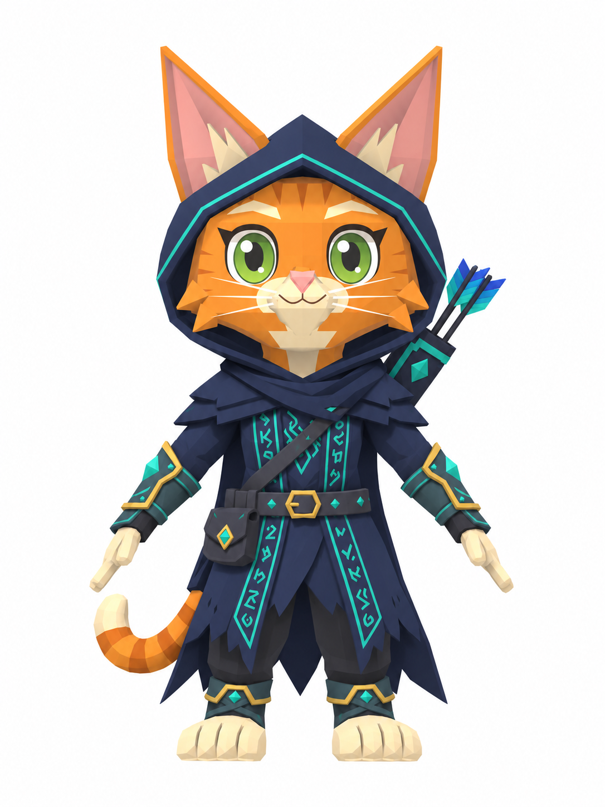

# Cat skin direction and saved concepts

Agreed with the owner, 24 November 2026. These are cosmetic design references and workflow decisions. The new
Spectral Ranger model, shaders, spirit effects and matching quiver are **not implemented** yet.

## Latest reference: match the actual game cat

Use [the current-game-matched spectral image](skin_concepts/current_game_match/spectral_ranger_matched.png) as the
latest Meshy 6 input. It supersedes the earlier rounded-face/turquoise-eye reference.

The identity reference is the shipping `game/assets/cat/CatRanger.glb`, selected by `hero_model: CatRanger`.
Its [front](skin_concepts/current_game_match/current_cat_front.png),
[face closeup](skin_concepts/current_game_match/current_cat_face.png) and
[side](skin_concepts/current_game_match/current_cat_side.png) were rendered directly from that file without changing
its geometry, textures or rig. The source hash is recorded in
[current_identity_source.json](skin_concepts/current_game_match/current_identity_source.json).

The owner requested that the current cat's details match exactly. Preserve its lime-green eyes and eye outlines,
small pink nose, angular orange cheeks, narrow cream muzzle/chin, eyebrows, ear tufts, hands/fingers, paw toes,
fur markings and striped cream-tipped tail. For an exact finished 3D match, reuse the original character meshes
and fit the generated clothing around them. The generated reference is a guide; a new Meshy reconstruction alone
does not establish identical geometry.

## Skin identity and scope

- Skins are complete cosmetic interpretations of the same recognizable heroine. Outfit silhouette, materials,
  colours, patterns and optional effects may vary. Face structure, characteristic proportions, ears, expressions
  and archer identity remain recognizable.
- The current approved spectral direction keeps the actual cat's identity unchanged. Its midnight-navy hood,
  layered mantle, split rune coat, teal/gold bracers and ankle guards, belt pouch and matching quiver carry the theme.
- The reference includes one visible natural tail. Turquoise markings are flat material details; flames, wisps,
  bloom, auras and other animated effects are omitted from the image used for reconstruction.
- The user uses the single-image Meshy 6 workflow. Upload one front-facing A-pose image for the chosen skin.
  Each concept is a different skin, not another angle of one model.
- Recolour/pattern variants can reuse an existing model. Substantial new garment shapes need a generated source,
  cleanup, fitting, rigging and animation checks. Existing tooling already reuses the shipping cat and skeleton;
  a general modular outfit system was discussed but has not been built.
- A complete GLB per skin remains compatible with the current loader. It can be assembled from the unchanged
  cat and new clothing. Cosmetic changes retain gameplay stats, upgrades, collision and attack timing.
- Check walking, shooting, the equipped bow/quiver, mounted poses and torso aiming before integration.

## Saved design history

The owner requested saving all session work on GitHub. These curated source references and exact generation
prompts are archived with the documentation; the local art pipeline, temporary renders and build outputs remain
outside the game source tree.

| Reference | Purpose |
|---|---|
| [Original spectral design](skin_concepts/original_spectral_reference.png) | User-supplied costume/effect inspiration. |
| [Canonical cat concept](skin_concepts/canonical_cat_concept.png) | Original design identity, superseded by direct shipping-model renders for exact matching. |
| [Initial multi-view pack](skin_concepts/initial_multiview/) | Earlier front/side/back exploration with prompts; the user later clarified Meshy 6 single-image input. |
| [Wispbound Ranger](skin_concepts/three_concepts/01_wispbound_ranger.png) | Dark teal spirit-wood robes, mint inlays and a visible tail. |
| [Dawnfire Ranger](skin_concepts/three_concepts/02_dawnfire_ranger.png) | Ivory/crimson outfit, golden feather mantle and sun motifs. |
| [Starforged Ranger](skin_concepts/three_concepts/03_starforged_ranger.png) | Silver fur, violet eyes and indigo celestial metalwork; exploratory palette variant. |
| [Earlier clean spectral image](skin_concepts/clean_design/spectral_ranger_clean.png) | No-effect A-pose with quiver and tail; predates the correction to the actual cat's face. |
| [Latest identity-matched image](skin_concepts/current_game_match/spectral_ranger_matched.png) | Current selected reference, with original green eyes and sharper face/hand details. |

All generated images used built-in image generation. Each folder includes the exact prompts and relevant notes.
Existing Desktop copies are preserved; the current image is `SpectralRanger-Meshy6-Matched-To-Game.png`.

## Next implementation step

The owner authorized generating the model in the existing incognito Chrome/Meshy 6 session, downloading the source
to the Desktop, fitting the new skin, adding turquoise effects/shaders and changing the quiver to match. Computer
Use stopped before generation because it could not confidently verify Chrome's current URL. No Meshy model was
submitted or downloaded, and no new Spectral Ranger skin was installed. Resume the browser/model step once the
visible Meshy window is accessible; then integrate using the approved identity-matched reference above.
